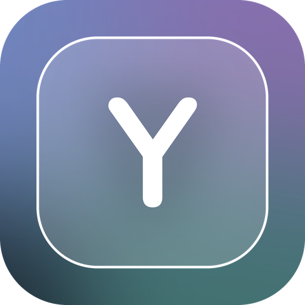
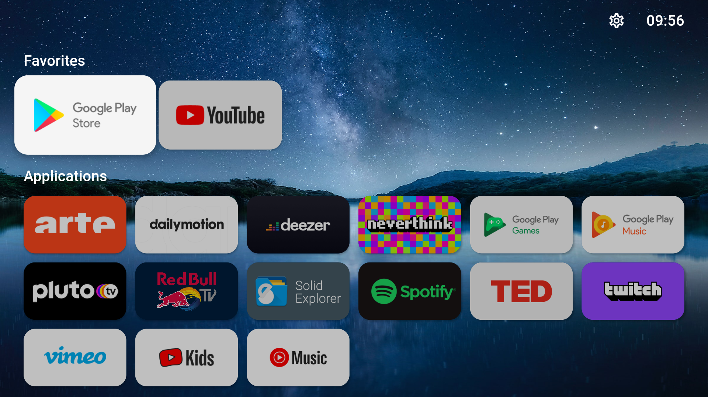
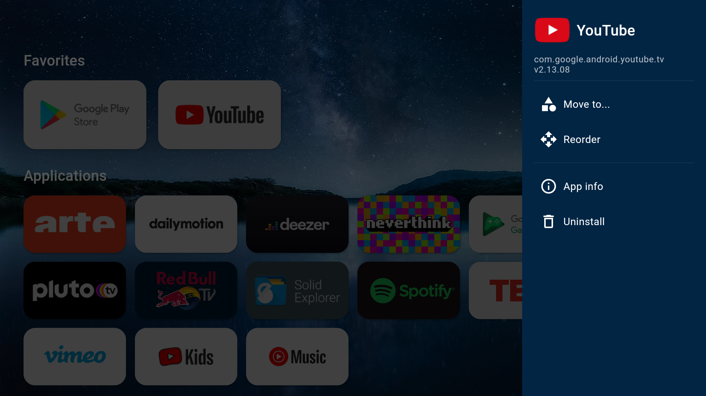
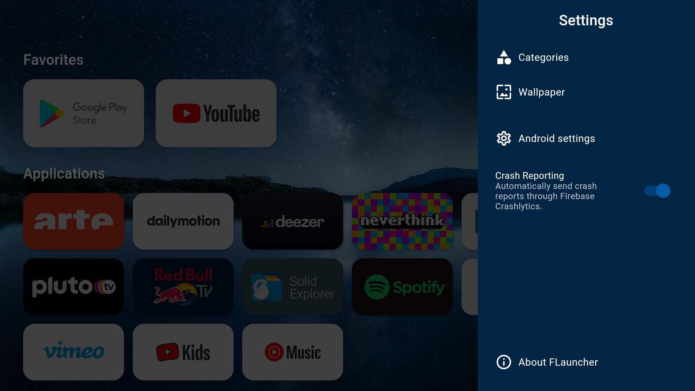

<p align="center"></p>

# YaMa Launcher

A glassy, soft home screen for **Android TV and Fire TV**, built on the open-source [FLauncher](https://github.com/osrosal/flauncher). Everything below is free, with no premium tier.

## What YaMa adds

**Look & layout** (Settings → Layout & cards)
- Apps at the top, or at the bottom to leave room for poster-style (TMDB) wallpapers
- Apps across the screen: 2 to 8 big cards, or per-category sizes (grids go down to 1 column)
- Rows shown at once for grids (e.g. 2 rows under a TMDB poster; the rest scroll inside)
- Card shape: wide banner, square icon or round icon, with a translucent background for icon cards
- App names: hidden, on the selected app only, or always
- Zoom on the selected app, corner roundness, space between apps and rows
- Left, right and top margins
- A soft glass "dock" behind each category (optionally frosted)
- Hide empty categories automatically
- Wider row-height (60–250) and grid-column (1–12) ranges per category
- Custom app icons: hold Select on an app → Change icon (uses your file explorer), or copy `<package>.png` files with ADB into `Android/data/app.yama.launcher/files/icons`

**Focus effects**
- Glow or drop shadow on the selected card
- Glow color, size and animation (breathe, pulse, color shimmer or still)
- Optional tint on the selected card, and dimming of the others

**Wallpaper**
- Gradient, single picture, solid color, a slideshow of your own pictures, **Reddit** (any subreddits, read from their public RSS feeds; tall pictures skipped) or **web image links**
- Slideshow timer (15 s to 6 h) and transitions: fade, zoom, slide sideways, slide up, or random
- Press **Play/Pause** on the remote for the next picture
- Blur, dim, brightness, color intensity, color tint and a soft top/bottom shadow

**Clock & text**
- Clock color, size and shadow; one-line or two-line (time above date)
- Fonts: **Poppins** (default), Nunito, Quicksand, Comfortaa, Inter, Lexend or the system font; adjustable text size
- Accent color for menus and switches

**Themes & idle**
- Three saved themes of your own, with names
- Built-in looks: YaMa Glass, Frosted Icons, Bubble, Night Calm, Poster (apps at bottom), Classic FLauncher
- Save your look to a file and load it back (`Android/data/app.yama.launcher/files/yama-theme.json`)
- Idle mode: after a set time the apps fade away, leaving the wallpaper and clock; the first button press only wakes the screen

## Building

Every push builds an APK in the **Actions** tab (artifact `yama-launcher-apk`). The app ID is `app.yama.launcher`, so it installs alongside FLauncher. Builds are signed with `android/app/personal-keystore.jks`, kept in this repository so new builds install over old ones.

## Credits & licence

YaMa Launcher is a modified version of FLauncher by Étienne Fesser and Oscar Rojas, and is released under the same **GNU GPL v3** licence (see `LICENSE`). Bundled fonts are under the SIL Open Font License (`assets/fonts/OFL-*.txt`).

The original FLauncher README follows.

---

# FLauncher (fork)
#### This is a fork of the GitLab repository at: https://gitlab.com/flauncher/flauncher.

FLauncher is an open-source alternative launcher for Android TV, built with [Flutter](https://flutter.dev).

## Download
Get the latest build from the [releases](https://github.com/osrosal/flauncher/releases) page, you can look for older builds on the [actions](https://github.com/CocoCR300/flauncher/actions) tab, where they are uploaded as artifacts.

## Features
For a list of the changes introduced by this fork from the original, see the [CHANGELOG](CHANGELOG.md) file.

- [x] No ads
- [x] Customizable categories
- [x] Manually reorder apps within categories
- [x] Wallpaper support
- [x] Open "Android Settings"
- [x] Open "App info"
- [x] Uninstall app
- [x] Clock
- [x] Switch between row and grid for categories
- [x] Support for non-TV (sideloaded) apps
- [x] Navigation sound feedback
- [ ] Force stop app

## Screenshots
|  |  |  |
|--|--|--|
|  |  |  |

## Set FLauncher as default launcher

### Method 1: remap the Home button
This is the "safer" and easiest way. Use [Button Mapper](https://play.google.com/store/apps/details?id=flar2.homebutton) to remap the Home button of the remote to launch FLauncher.

### Method 2: disable the default launcher
**:warning: Disclaimer :warning:**

**You are doing this at your own risk, and you'll be responsible in any case of malfunction on your device.**

The following commands have been tested on Chromecast with Google TV only. This may be different on other devices.

Once the default launcher is disabled, press the Home button on the remote, and you'll be prompted by the system to choose which app to set as default.

#### Disable default launcher
```shell
# Disable com.google.android.apps.tv.launcherx which is the default launcher on CCwGTV
$ adb shell pm disable-user --user 0 com.google.android.apps.tv.launcherx
# com.google.android.tungsten.setupwraith will then be used as a 'fallback' and will automatically
# re-enable the default launcher, so disable it as well
$ adb shell pm disable-user --user 0 com.google.android.tungsten.setupwraith
```

#### Re-enable default launcher
```shell
$ adb shell pm enable com.google.android.apps.tv.launcherx
$ adb shell pm enable com.google.android.tungsten.setupwraith
```

#### Known issues
On Chromecast with Google TV (maybe others), the "YouTube" remote button will stop working if the default launcher is disabled. As a workaround, you can use [Button Mapper](https://play.google.com/store/apps/details?id=flar2.homebutton) to remap it correctly.

## Wallpaper
Because Android's `WallpaperManager` is not available on some Android TV devices, FLauncher implements its own wallpaper management method.

Please note that changing wallpaper requires a file explorer to be installed on the device in order to pick a file.

## Support the original author: [etienn01](https://github.com/etienn01)
<a href="https://www.buymeacoffee.com/etienn01" target="_blank"></a>
